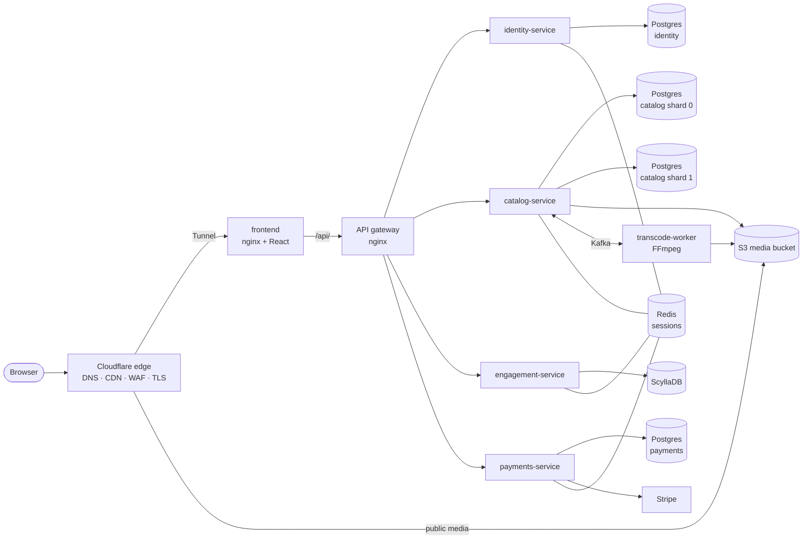

# ITube microservices

ITube used to be one Spring Boot application (a monolith). It is now five services that are built, deployed and
scaled separately, plus an API gateway. This page explains what each one does, how they talk to each other, and
why it is built this way. The related pages go deeper:

| Topic | Page |
|---|---|
| Spreading the catalog over several databases | [SHARDING.md](SHARDING.md) |
| Cloudflare DNS, CDN and Tunnel | [CDN-AND-DNS.md](CDN-AND-DNS.md) |
| Timeouts, retries, circuit breakers, load shedding, load tests, capacity for 100M users | [RESILIENCE-AND-SCALE.md](RESILIENCE-AND-SCALE.md) |
| Which store holds which data | [DATA-ARCHITECTURE.md](DATA-ARCHITECTURE.md) |
| BDD (Cucumber) and end-to-end tests | [TESTING.md](TESTING.md) |

## The services

| Service | Port (local) | Owns | Public API | Scales by |
|---|---|---|---|---|
| **identity-service** | 8081 | accounts, passwords (Postgres schema `identity`) | `/api/auth/**`, `/api/session/**` | CPU (BCrypt) |
| **catalog-service** | 8082 | channels, subscriptions, video metadata, uploads, playback (Postgres, **sharded**), the media bucket | `/api/channels/**`, `/api/videos/**` (not comments), `/api/uploads/**` | replicas + caches + shards |
| **engagement-service** | 8083 | watch history, likes, comments (ScyllaDB) | `/api/history/**`, `/api/liked-videos/**`, `/api/videos/{id}/comments` | replicas + Scylla nodes |
| **payments-service** | 8084 | Stripe customers, membership tiers, memberships, payments (Postgres schema `payments`) | `/api/memberships/**`, `/api/payments/**`, `/api/webhooks/stripe` | rarely needed |
| **transcode-worker** | 8085 (health only) | nothing: reads sources, writes renditions | none (Kafka only) | pods, up to the topic's 6 partitions |
| **gateway** | 8080 | nothing | routes all of the above | stateless replicas |

All code lives in one Maven build ([backend/pom.xml](../backend/pom.xml)) with two shared libraries:
`common` (session user, service clients with resilience, Caffeine, Kafka retries, load shedding) and `storage`
(S3-compatible object storage). Each service is still its own jar, image and Kubernetes Deployment.

## Why split it up

- **Scale what's busy.** Watching and browsing (catalog) is thousands of times busier than paying (payments). Each
  service now gets the number of pods it needs, chosen automatically by its HorizontalPodAutoscaler.
- **Contain failures.** If payments or the transcoder crashes, people can still sign in, browse, watch, like and
  comment. Each service has its own threads, memory, database connections and deploy.
- **Pick the right store per job.** History and likes are huge, append-mostly and per user (ScyllaDB); money needs
  one strongly consistent database (Postgres, not sharded); video metadata is read-heavy (Postgres, sharded and cached).
- **Deploy independently.** A change to comments only rebuilds and redeploys engagement-service.

The cost: calls that used to be method calls now cross the network, and one database transaction can no longer
span two domains. The rest of this page is about how ITube handles that.

## How services talk to each other

### 1. Synchronous HTTP for questions that need an answer now

Example: History needs the titles of the videos it lists, which belong to the catalog. engagement-service calls
`POST /internal/videos/summaries` on catalog-service.

- **Internal APIs live under `/internal/**`**. The gateway never routes them, and every service checks a shared token
  (`X-Internal-Token`, from the `INTERNAL_API_TOKEN` secret) on them.
- **Typed clients** in `common` ([CatalogClient](../backend/common/src/main/java/ITubeBackend/common/client/CatalogClient.java),
  `IdentityClient`, `PaymentsClient`) hide the HTTP. Tests replace them with fakes.
- **Every call is protected** ([Downstream](../backend/common/src/main/java/ITubeBackend/common/client/Downstream.java)):
  1-2 s timeouts, retries with backoff, a circuit breaker and a bulkhead (Resilience4j). See
  [RESILIENCE-AND-SCALE.md](RESILIENCE-AND-SCALE.md).
- **Answers are cached** in Caffeine (video summaries 30 s, channels 60 s, accounts 5 min), so most calls never
  leave the process.
- **The caller decides what an outage means.** History shows entries without titles; comments still post; paid
  videos refuse to play (fail closed) while public videos never ask payments at all.

### 2. Kafka events for things that can happen a moment later

| Topic | From -> to | Why |
|---|---|---|
| `video.transcode` | catalog -> transcode-worker | Uploading never waits for FFmpeg |
| `video.transcoded` | transcode-worker -> catalog | Renditions ready (or FAILED) |
| `video.deleted` | catalog -> catalog (media cleanup) + engagement (likes/comments cleanup) | One delete, several owners |
| `account.created` | identity -> catalog | Create the first channel when the catalog was down at registration |
| `catalog.cache-invalidation` | catalog -> every catalog pod | Evict a changed video from every pod's cache |
| `membership.*` | payments -> (future consumers) | Through the transactional outbox |

Events carry ids and storage keys, never media bytes. Every consumer is **idempotent** (running it twice changes
nothing), failed messages are retried with backoff and then parked on `<topic>-dlt` (dead-letter topic), and a
sweeper re-sends transcode jobs that got lost. Details in [RESILIENCE-AND-SCALE.md](RESILIENCE-AND-SCALE.md).

### 3. A shared session for "who is signed in"

Signing in (identity-service) stores `userId`, `channelId` and the display name in a Redis-backed session. Every
service uses Spring Session with the same Redis and cookie, so every service knows the user without asking
identity-service. Comments, for example, are signed with the name from the session.

> Production systems often use signed tokens (JWT) instead, so that not even Redis is needed per request. The
> shared session was kept because it needed no frontend change; [CurrentUser](../backend/common/src/main/java/ITubeBackend/security/CurrentUser.java)
> is the only class that would change.

## No transaction across services

Registration used to insert the account and its channel in one transaction. Now:

1. identity-service commits the account;
2. it asks catalog-service to create the channel (`POST /internal/channels`, safe to retry: it creates at most one
   channel per user and name);
3. if the catalog is unavailable, registration still succeeds and identity publishes `account.created`; the catalog
   creates the channel when it reads the event.

This "do it now, or make sure it happens later" pattern (eventual consistency) replaces distributed transactions,
which don't scale. A video delete works the same way: the catalog row goes at once, and files, likes and comments
are cleaned up by `video.deleted` consumers.

## The API gateway

[gateway/templates/default.conf.template](../gateway/templates/default.conf.template) (nginx):

- routes by path, so the browser and frontend still see one origin and the URLs didn't change;
- blocks `/internal/**` and `/actuator/**`;
- rate-limits per client IP (stricter for sign-in), taking the real IP from Cloudflare's `CF-Connecting-IP`;
- fails fast (2 s connect timeout) and retries safe requests (GET, never POST) once on another pod;
- keeps connection pools to every service.

## Running it

- **Locally:** `.\dev.cmd` starts the data stores, gateway and transcode worker in Docker and the four services as
  separate windows ([README](../README.md)).
- **Kubernetes:** [deploy/k8s](../deploy/k8s) has a Deployment, Service, HorizontalPodAutoscaler and
  PodDisruptionBudget per service; [deploy/README.md](../deploy/README.md) describes the pipeline.
