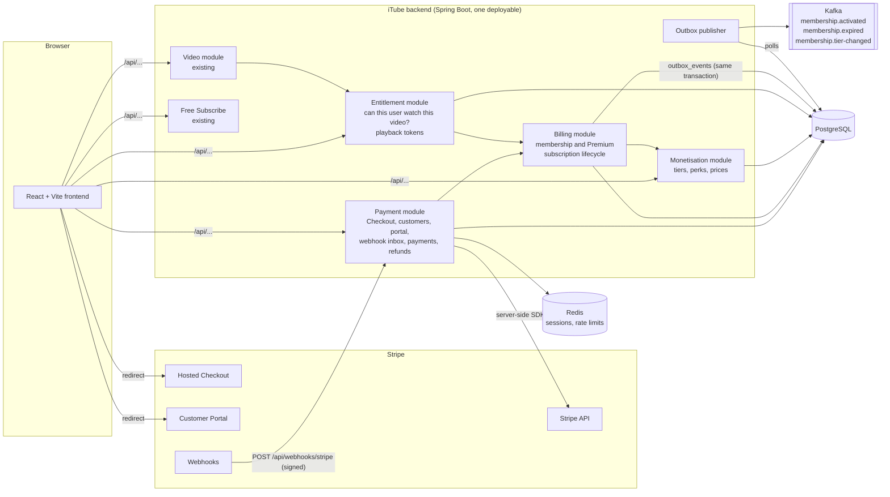

# iTube monetisation: architecture and implementation plan

This document covers how iTube takes money with Stripe: paid channel memberships, iTube Premium, tips, and creator payouts. It also explains the decisions behind the design and what is built in each phase.

> **Status:** Phase 1 (Stripe setup, Checkout) and Phase 2 (paid channel memberships, webhooks, members-only playback) are implemented on the `feature/stripe-payments` branch. Phases 3–6 are designed here but not built.

## 1. What the existing project looks like (and how that shaped the design)

The requirements were written for a Spring Cloud microservice estate. The repository on the `video` branch is different, so the design follows what actually exists:

| Requirement assumed | What the repo actually has | Decision |
|---|---|---|
| Separate microservices | One Spring Boot 4.1 app (Java 21) | Build the monetisation services as **modules inside the existing app**, split by package and database table ownership, so they can be extracted later (see §3). |
| API Gateway | None. The Vite dev server proxies `/api/` to `:8080` | Rate limiting is done in the app with Redis (§9). Move it to a gateway when one exists. |
| JWT / Spring Security | None. Users are identified by a Redis-backed `HttpSession` holding `userId`, created by the temporary `/api/session/dev` endpoints (login isn't finished yet) | New endpoints read the user from the session through `security/CurrentUser`, never from a client-supplied ID. When JWT login lands, only `CurrentUser` changes. |
| HLS + CDN signed cookies | Videos and renditions are MP4 bytes in PostgreSQL, served by `/api/videos/{id}/file` and `/renditions/{q}` | Playback is authorised with **short-lived HMAC-signed tokens**, the same model as CDN signed URLs (§6). When media moves to object storage and a CDN, the token issuer switches to CDN-signed URLs/cookies and the endpoints stay the same. |
| Flyway migrations | `schema.sql` run on every start (`CREATE TABLE IF NOT EXISTS`), `ddl-auto=validate` | New tables live in `schema-payments.sql` in the same idempotent style. Moving the project to Flyway is recommended before production. |
| Kafka, Redis, PostgreSQL, Docker | Present (Terraform-managed Docker in `tf_docker/`) | Reused. |
| Free Subscribe | Already exists (`SubscriptionService`, `subscriptions` table) | Left untouched. It never calls Stripe. |

## 2. Architecture

### Which modules are combined now and which split later

| Module | Owns tables | First release | Extract when |
|---|---|---|---|
| Payment + Billing | `payment_customers`, `checkout_sessions`, `payments`, `refund_records`, `webhook_inbox`, `outbox_events`, `channel_memberships`, `premium_subscriptions` | One module (`service/payments`). They share the webhook transaction, and splitting them early adds a distributed-transaction problem for no gain. | Webhook volume or the team structure needs it. Billing becomes a consumer of payment events. |
| Monetisation | `channel_membership_tiers`, `membership_perks` | `service/memberships` | Creator Studio grows (perks, emojis, badges). |
| Entitlement | Reads `channel_memberships` and tiers; owns no tables | `service/entitlement` | Playback traffic is large enough to need its own scaling. It then builds its own read model from the `membership.*` Kafka events and caches in Redis. **This is the first candidate to scale independently.** |
| Creator Payout | `creator_stripe_accounts`, `creator_earnings` | Phase 5 | Payout reconciliation jobs get heavy. |

## 3. Money flows

### Paid channel membership (Phase 2, implemented)

1. A viewer clicks **Join** and picks a tier. The frontend calls `POST /api/payments/checkout/channel-membership` with `{ tierId }`. **No price is sent from the browser.**
2. The backend takes a per-user Postgres advisory lock (to stop double-clicks creating two sessions), checks rate limits, and checks the viewer isn't already a member. It reuses an open Checkout Session for the same tier, or expires an open one for a different tier. It then finds or creates the Stripe Customer and creates a Checkout Session in `subscription` mode with the tier's Stripe Price.
3. The browser is redirected to Stripe-hosted Checkout. iTube never sees card details.
4. Stripe redirects back to `/memberships/checkout-complete`. That page **only polls** iTube for status; it grants nothing.
5. Stripe sends webhooks (`checkout.session.completed`, `customer.subscription.created`, `invoice.paid`, …). Each is signature-checked, stored in `webhook_inbox`, and acknowledged.
6. A background processor handles each inbox row. For anything subscription-related it **re-fetches the Subscription from Stripe** and upserts `channel_memberships` from that authoritative copy. Because every event triggers a fresh read, duplicate and out-of-order events converge on the same state.
7. If the membership moves from "no access" to "access", a `membership.activated` row is written to `outbox_events` **in the same transaction**. The outbox publisher sends it to Kafka after commit. Losing access writes `membership.expired`.

Subscriptions map to iTube records through Stripe's object graph rather than metadata. The Subscription's Price → Product maps to `channel_membership_tiers.stripe_product_id`, which gives the channel. The Customer maps to `payment_customers.stripe_customer_id`, which gives the user. Metadata is set only as a debugging aid.

**Access policy** (configurable in `application.properties`):

| Stripe subscription status | Access |
|---|---|
| `active`, `trialing` | Yes, until `current_period_end` + grace period |
| `past_due` (renewal failed, Stripe is retrying) | Yes, if `itube.memberships.past-due-access=true` (default), otherwise no |
| `canceled`, `unpaid`, `incomplete`, `incomplete_expired`, `paused` | No |

If a viewer cancels, the subscription stays `active` with `cancel_at_period_end=true` until the paid period ends, then becomes `canceled`. Access ends at the end of the period they paid for.

**Upgrades and downgrades** use `POST /api/memberships/{id}/tier`. An upgrade invoices the prorated difference immediately and only applies if that payment succeeds (`payment_behavior=pending_if_incomplete`). A downgrade applies immediately, with the unused amount credited against the next invoice.

### iTube Premium (Phase 3, designed)
The same flow as memberships, using one platform-owned Product with monthly Prices, the `premium_subscriptions` table, and `premium.activated` / `premium.expired` events. Premium entitlement is checked separately from channel memberships: the two are never merged.

### Tips / Super Thanks (Phase 4, designed)
Checkout in `payment` mode with amounts chosen from a server-side list (`{200, 500, 1000, 2000}` pence). The frontend sends only the option key. Fulfil on `checkout.session.completed` / `checkout.session.async_payment_succeeded`, but only when `payment_status` is not `unpaid`. Store the result in `payments` with the platform fee and creator earnings split, and add a `creator_earnings` ledger entry.

### Creator payouts (Phase 5, designed). Recommended Connect configuration

These recommendations follow Stripe's Connect guidance for subscription platforms:

| Decision | Recommendation | Why |
|---|---|---|
| Account API | **Accounts v2** (`/v2/core/accounts`), recipient configuration with `stripe_balance.stripe_transfers` | v1 `type: express/custom` is deprecated. Creators only need to *receive* funds, not run card payments. |
| Dashboard | `express` | Lightweight Stripe-hosted dashboard for creators. Access it through login links. |
| Onboarding | Stripe-hosted Account Links / embedded `account_onboarding` + `notification_banner` | Stripe collects ID documents and bank details, so iTube never stores them. |
| Charge model | **Destination charges**: `subscription_data.transfer_data.destination` + `application_fee_percent` for memberships, `payment_intent_data.transfer_data` + `application_fee_amount` for tips | iTube runs checkout for viewers, which makes it a marketplace and merchant of record. |
| Fees collector | `application` | iTube pays Stripe's processing fees and recovers them through its application fee. |
| Losses collector | `application` | Required with destination charges. iTube is liable for negative balances. |

What this means:
- **Merchant of record:** iTube. The viewer's statement shows iTube, and iTube is responsible for receipts, VAT and consumer rights.
- **Stripe fees:** charged to iTube's platform balance. Set the platform commission (`itube.payments.platform-fee-bps`) high enough to cover them. **The commission defaults to 0 and must be set by a business decision. It deliberately does not copy YouTube's rates.**
- **Refunds and disputes:** handled by iTube. Refunds use `reverse_transfer=true` and `refund_application_fee` as appropriate. Dispute losses debit the platform first, and iTube can reverse the matching transfer from the creator.
- **Negative balances:** iTube's liability.
- **Transfer ≠ payout:** a *transfer* moves money into the creator's Stripe balance. A *payout* moves money from that balance to their bank, on the account's payout schedule. Creator Studio shows both states separately.
- **Gating:** in production, a creator can't publish paid tiers until their account's `stripe_transfers` capability is `active`. In Phase 2 (sandbox, before Connect exists), membership revenue accrues in the platform balance and is ledgered for later.

## 4. Stripe Identity, PCI DSS and UK GDPR

- **Identity verification:** Connect onboarding already performs KYC for creators who receive money, so a separate Stripe Identity check is *not* added for payouts. Use Stripe Identity (hosted VerificationSession) only for a specific need, such as age assurance for restricted content or high-risk creators flagged by fraud review. Store only the VerificationSession ID and its status, never document images.
- **PCI DSS:** Only Stripe-hosted Checkout and the Customer Portal collect card details, which keeps iTube at the lightest self-assessment level (SAQ A). No card number, CVC or bank detail ever reaches iTube's servers, logs or database.
- **Data minimisation:** iTube sends Stripe only the account email, used for receipts. Metadata carries internal numeric IDs only. Kafka events carry IDs and states only, with no names or emails. Logs record Stripe object IDs and error codes, never request bodies or keys.
- **Secrets:** `STRIPE_SECRET_KEY` and `STRIPE_WEBHOOK_SECRET` come from environment variables (or a local, git-ignored `backend/.env` in development). In production, use the platform's secrets manager and a **restricted API key** (`rk_…`) limited to Customers, Checkout Sessions, Subscriptions, Products, Prices, Billing Portal, Invoices (read), Charges/Refunds (read) and Disputes (read).
- **Retention and deletion:** `webhook_inbox` payloads can contain customer data, so processed rows are purged after `itube.stripe.webhook-retention` (default 30 days). Financial records (`payments`, `refund_records`) are kept for the statutory period (6 years in the UK); on account deletion they are anonymised through `user_id ON DELETE SET NULL`. The Stripe Customer can be deleted through the API as part of an erasure request.
- **Managed Payments:** the sandbox account has Stripe Managed Payments **on by default**. That makes Stripe the merchant of record for digital goods, which conflicts with the Connect plan in §3, so iTube must decide before launch. Either way, tier Products now carry a tax code (`itube.payments.membership-tax-code`, default `txcd_10402200`, streamed audio-visual subscription), which both Managed Payments and Stripe Tax require.
- **Still to review before launch:** VAT (consider Stripe Tax, which only collects tax once a registration is active), age restrictions for paying users, and app-store billing rules if native mobile apps are released.

## 5. Database

The schema is in `backend/src/main/resources/schema-payments.sql`. Conventions:
- Money is in **minor units** (`*_minor BIGINT`, pence) plus a 3-letter `currency`.
- Local IDs are `BIGINT` identities. Stripe IDs are stored separately as `stripe_*_id VARCHAR(255)`, each with a `UNIQUE` constraint.
- States are `VARCHAR` with `CHECK` constraints. Timestamps are `TIMESTAMPTZ`.

| Table | Purpose | Key constraints |
|---|---|---|
| `payment_customers` | iTube user → Stripe Customer | `UNIQUE(user_id)`, `UNIQUE(stripe_customer_id)` |
| `checkout_sessions` | Every Checkout Session iTube created, to reuse or expire on repeat clicks | `UNIQUE(stripe_checkout_session_id)` |
| `channel_membership_tiers` | Creator-defined tiers, one Stripe Product each | one active tier per `(channel_id, level)`; `UNIQUE(stripe_product_id)` |
| `membership_perks` | Perks per tier. Higher levels inherit lower-level perks at read time | FK → tier |
| `channel_memberships` | Local copy of each membership Subscription | `UNIQUE(stripe_subscription_id)`; **one live membership per (user, channel)** (partial unique index) |
| `payments` | Every successful or failed charge (membership invoices now, tips later) with fee split | `UNIQUE(stripe_invoice_id)`, `UNIQUE(stripe_payment_intent_id)` |
| `refund_records` | Refunds and disputes against a payment | one cumulative `REFUND` row per charge (partial unique index), `UNIQUE(stripe_dispute_id)` |
| `webhook_inbox` | Durable, deduplicated Stripe events | `UNIQUE(stripe_event_id)` |
| `outbox_events` | Kafka events written in the same transaction as the state change | `UNIQUE(event_id)` |
| `premium_subscriptions` | Phase 3 | one live Premium per user |
| `creator_stripe_accounts` | Phase 5 | `UNIQUE(user_id)`, `UNIQUE(stripe_account_id)` |
| `creator_earnings` | Phase 4–5 ledger (signed amounts) | `UNIQUE(payment_id, entry_type)` |
| `video` (changed) | adds `visibility` and `required_tier_level` | `CHECK` on visibility |

## 6. Members-only playback

- `video.visibility` is one of `PUBLIC`, `UNLISTED`, `PRIVATE` or `MEMBERS_ONLY`. A `MEMBERS_ONLY` video can also set `required_tier_level`; viewers on that tier level or higher can watch.
- `GET /api/videos/{id}/playback-authorisation` checks the viewer's entitlement **on the server**. If they're allowed, it returns a token valid for `itube.playback.token-ttl` (default 10 minutes), signed with HMAC-SHA256, bound to the video and user.
- `/api/videos/{id}/file` and `/renditions/{quality}` **refuse** non-public videos unless the request carries a valid token. Hiding the player in the frontend is not the security boundary.
- Feeds and channel pages list `MEMBERS_ONLY` videos with a badge but no playable URL. `PRIVATE` and `UNLISTED` videos are not listed.
- When access ends, new tokens are refused immediately. An already-issued token keeps working for at most its TTL.

## 7. Webhooks and reliability

- **Endpoint:** `POST /api/webhooks/stripe`. There is no session on this endpoint, but the signature is always verified against the **raw request body**. Requests with a bad signature get `400`.
- **Inbox:** an `INSERT … ON CONFLICT (stripe_event_id) DO NOTHING` into `webhook_inbox` happens *before* the `200` response. If the database is down, Stripe receives a `500` and retries.
- **Processor:** polls the inbox with `FOR UPDATE SKIP LOCKED`, so several app instances can run it safely. It processes each event in its own transaction and retries failures with exponential backoff. After `max-attempts` an event is marked `FAILED` (dead letter), logged, and counted in the `itube.stripe.webhook.failed` metric.
- **Idempotency:** duplicate events are dropped by the unique event ID. Every state change is an upsert keyed by a Stripe ID. Entitlement events fire only when access actually changes, so replaying an event can't create a second membership or a second `membership.activated`.
- **Outbox:** Kafka events are published only after the database transaction commits, with retries and a `FAILED` state.

Events handled: `checkout.session.completed`, `checkout.session.async_payment_succeeded`, `checkout.session.async_payment_failed`, `checkout.session.expired`, `customer.subscription.created/updated/deleted/paused/resumed`, `invoice.paid`, `invoice.payment_failed`, `charge.refunded`, `charge.dispute.created`, `charge.dispute.closed`, `radar.early_fraud_warning.created`.

## 8. API (Phases 1–2)

| Method | Path | Auth | Purpose |
|---|---|---|---|
| GET | `/api/memberships/channels/{channelId}/tiers` | optional | Tiers, prices, cumulative perks, and the viewer's current tier |
| POST | `/api/memberships/channels/{channelId}/tiers` | channel owner | Create a tier (creates a Stripe Product and Price) |
| PATCH | `/api/memberships/tiers/{tierId}` | channel owner | Rename, change perks, or change price (new Price; existing members keep their old price) |
| DELETE | `/api/memberships/tiers/{tierId}` | channel owner | Archive (no new members; existing ones continue) |
| POST | `/api/payments/checkout/channel-membership` | session | Start Checkout. Body: `{ tierId }` |
| GET | `/api/payments/checkout/sessions/{sessionId}` | session (own only) | Status for the return page |
| GET | `/api/memberships/me` | session | My memberships |
| POST | `/api/memberships/{id}/tier` | session (own only) | Upgrade or downgrade |
| POST | `/api/memberships/{id}/cancel` / `/resume` | session (own only) | Cancel at period end, or undo |
| POST | `/api/payments/billing-portal` | session | Stripe Customer Portal link |
| POST | `/api/webhooks/stripe` | Stripe signature | Webhook receiver |
| GET | `/api/videos/{videoId}/playback-authorisation` | optional | Playback token or reason for refusal |

Phase 3+ endpoints from the brief (`/checkout/premium`, `/checkout/tip`, `/premium/status`, `/creators/connect/onboarding`, `/creators/earnings`) are not built yet.

## 9. Rate limiting and observability

- Checkout creation, tier changes and portal sessions are limited per user with a Redis fixed-window counter (`itube.payments.rate-limit.*`). If Redis is down the limiter allows the request and logs a warning; Stripe's own rate limits still apply.
- Actuator exposes `health` (DB, Redis, Kafka) and `metrics`. Counters: `itube.stripe.webhook.received`, `.processed`, `.failed`, `itube.outbox.published`, `itube.outbox.failed`. Traces and logs go to the existing OpenTelemetry pipeline (Grafana LGTM).

## 10. Verified in the Stripe sandbox

Besides the 52 automated tests, the integration was run end to end against real infrastructure (PostgreSQL, Redis and Kafka in Docker) and the Stripe sandbox, on 3 November 2026:

- The schema migration and Hibernate validation pass. Tier creation makes real Stripe Products and Prices. Checkout Sessions are created, reused on repeat clicks, and expired when the tier changes.
- A real Subscription was created with Stripe's test card. Its real events were fetched from Stripe, signed with the local webhook secret, and delivered **newest first and twice each**. The result was one membership, one £2.99 payment row, and exactly one `membership.activated` message on Kafka.
- Members-only playback: no token gives `403`; non-members get `MEMBERSHIP_REQUIRED`; signed-out viewers get `SIGN_IN_REQUIRED`; the member's token works for that video only and is sent with `no-store`; a Supporter on a VIP video gets `HIGHER_TIER_REQUIRED`.
- Upgrading to VIP produced a real prorated £7.00 invoice and `membership.tier-changed`. Cancelling at period end kept access. Ending the subscription produced `membership.expired` and removed access, and the late `customer.subscription.created` replay changed nothing.
- A real refund was traced through Stripe's object graph (PaymentIntent → invoice → local payment) and recorded as `REFUNDED`. A forged signature got `400`, and the billing portal opened.
- **Found and fixed:** Checkout was rejected because Managed Payments requires a product tax code (see §4).
- **Not run:** a real browser completing hosted Checkout (the subscription was created through the API with the same result), and the Stripe CLI, which wasn't available in the build environment.

## 11. Phases

| Phase | Scope | Status |
|---|---|---|
| 1 | Plan, Stripe sandbox config, customers, Checkout | **Done** |
| 2 | Membership tiers, subscription Checkout, webhooks, inbox/outbox, entitlement, members-only playback, Join UI | **Done** |
| 3 | iTube Premium plans, status, Premium Checkout | Designed |
| 4 | Tips, earnings ledger, Creator Studio dashboards | Designed |
| 5 | Connect (Accounts v2) onboarding, destination charges, payout reconciliation | Designed |
| 6 | Gifted memberships, paid live chat, merchandise | Not started |
